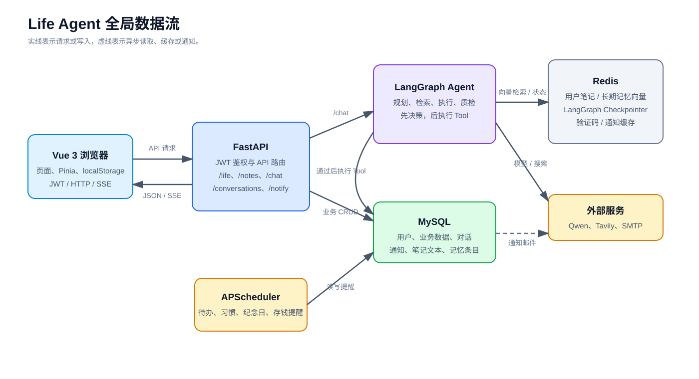
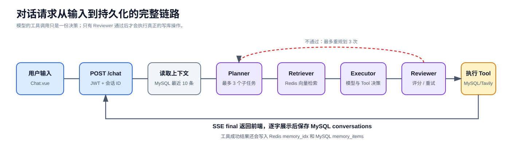

# Life Agent 数据流说明

本文档基于当前仓库代码梳理，描述 Life Agent 的真实数据流、各存储的职责，以及目前需要注意的数据一致性问题。

## 1. 全局数据流



## 2. 存储职责

| 存储位置 | 数据内容 | 是否为业务事实来源 |
| --- | --- | --- |
| MySQL | 用户、刷新令牌、记账、待办、习惯、日记、喝水、存钱、纪念日、通知、对话、笔记原文、记忆展示条目 | 是 |
| Redis Vector Store | 用户笔记切片向量、长期经验记忆向量 | 否，仅作为语义检索索引 |
| Redis Checkpointer | LangGraph 的执行状态 | 否，仅用于图运行状态 |
| Redis 普通 KV | 邮箱验证码、验证码冷却、通知列表缓存 | 否，缓存或临时数据 |
| 浏览器 localStorage | JWT、刷新令牌、Pinia 运行态、会话本地副本、部分页面缓存和旧版生活数据 | 否，前端缓存与兼容同步来源 |

## 3. 认证与用户隔离

1. 用户注册或登录后，后端从 MySQL 校验账号和密码。
2. 后端签发 access token 与 refresh token；前端保存到 `localStorage`。
3. 前端 API 请求携带 `Authorization: Bearer <access_token>`。
4. FastAPI 的 `get_current_user` 从 JWT 中读取 `user_id` 并加载 MySQL `User`。
5. 业务 SQL 查询按 `user_id` 过滤；向量索引按 `user:{uid}:notes_idx` 与 `user:{uid}:memory_idx` 区分。

## 4. 普通业务页面

记账、待办、习惯、日记、喝水、存钱和纪念日页面走常规 REST API。

```text
Vue 页面
  -> /life/* API
  -> JWT 解析当前用户
  -> MySQL 对应业务表
  -> JSON 返回页面更新
```

例如，用户在记账页新增一笔餐饮支出：

```text
Accounting.vue
  -> POST /life/expenses
  -> Expense(user_id, amount, category, note)
  -> MySQL expenses 表
  -> 页面重新 GET /life/expenses
```

对话 Agent 的 `record_expense` 工具最终也写入同一张 `expenses` 表，因此页面操作与对话操作的业务数据会汇合。

## 5. 对话 Agent 主链路



### 5.1 前端发起

1. `Chat.vue` 先将用户消息写入 Pinia `run` Store，并持久化到 `localStorage`。
2. 前端通过 `fetch` 调用 `POST /chat`，传递消息、会话 ID 和联网搜索开关。
3. 前端保持 SSE 连接，依次处理节点状态、模型 token、工具调用和最终结果。

### 5.2 后端编排

1. `/chat` 根据 JWT 获得当前用户。
2. 从 MySQL `conversations` 读取当前会话最近 10 条消息，作为追问上下文。
3. 用当前用户和会话 ID 创建 LangGraph；每次请求使用新的 `thread_id`，避免上一轮的中间状态串入当前请求。
4. `Planner` 用 LLM 将任务拆为最多 3 个子任务。
5. `Retriever` 在当前用户的笔记和经验记忆向量库中各检索最多 6 条相关内容。
6. `Executor` 使用绑定工具的 LLM 流式生成回复，并收集工具调用决策；每个子任务最多等待 60 秒。
7. `Synthesizer` 在多子任务时汇总文本结果。
8. `Reviewer` 为回答评分。低于 7 分时回到 Planner；普通问题最多重试 3 次，资料类问题最多重试 1 次。

### 5.3 工具延迟执行

Executor 中模型做出的 Tool Calling 决策不会立即写数据。

```text
模型输出 tool_calls
  -> 保存在 LangGraph State
  -> Reviewer 质检通过
  -> chat.py 注入真实 uid
  -> TOOL_MAP[name].ainvoke(args)
  -> MySQL、Redis 或 Tavily
```

这样 Reviewer 打回重规划时，不会重复创建待办、重复记账或重复打卡。

当前代码中实际注册了 15 个工具：

- 记账：`record_expense`、`query_expenses`
- 待办：`create_todo`
- 日记：`write_diary`
- 联网：`web_search`
- 习惯：`check_habit`、`query_habits`
- 纪念日：`add_anniversary`、`query_anniversary`
- 喝水：`record_water`、`query_water`
- 存钱：`query_savings`、`update_savings`
- 资料和记忆：`query_notes`、`query_memory`

### 5.4 回答和对话保存

1. 有工具结果时，工具结果优先成为答案；长的联网结果再由 LLM 归纳。
2. 资料类问题优先以笔记/记忆检索结果回答；没有检索命中时，出口强制返回“资料里未找到”，避免编造。
3. 工具成功执行后的问题和摘要会写入 Redis `memory_idx`，同时写入 MySQL `memory_items`。
4. 前端收到 `final` 事件后逐字展示回答，再调用 `/conversations` 保存完整会话消息。

## 6. SSE 事件流

后端 `POST /chat` 返回 `text/event-stream`，事件包括：

| 事件 | 用途 |
| --- | --- |
| `node_start` | 标记 Supervisor、Planner、Retriever、Executor、Synthesizer、Reviewer 开始运行 |
| `node_end` | 结束节点并附带计划、子任务索引或审核评分 |
| `token` | LLM 流式输出的文本片段 |
| `tool_call` | 模型决策调用的工具及参数 |
| `final` | 用户最终看到的回答 |
| `error` | 错误消息及异常类型 |

## 7. 笔记知识库

```text
上传 MD/TXT/PDF/DOCX
  -> 后端读取文件字节
  -> 提取文本
  -> 800 字符切片，100 字符重叠
  -> Embedding
  -> Redis user:{uid}:notes_idx
  -> MySQL notes 保存 doc_id、文件名、全文
```

对话 Retriever 使用当前用户的 `notes_idx` 做相似度检索，命中的片段会携带来源文件名并注入 Agent。

删除笔记时，系统先按 `doc_id` 清除 Redis 中该笔记的所有切片向量，再删除 MySQL `notes` 记录。

注意：上传的原始 PDF/Word 文件目前没有被持久化保存。代码只保存解析后的文本和向量；`uploads/` 的实际用途主要是用户头像。

## 8. 长期记忆与对话历史

系统存在两种不同的“记忆”：

| 类型 | 位置 | 目的 |
| --- | --- | --- |
| 对话历史 | MySQL `conversations.messages` | 取最近 10 条消息理解追问 |
| 长期经验记忆 | Redis `memory_idx` + MySQL `memory_items` | 语义检索与“经验记忆”页面展示 |

只有工具真正执行并返回结果时，系统才会沉淀长期经验记忆，减少把模型猜测写进记忆库的风险。

## 9. 定时提醒

```text
APScheduler
  -> 查询 MySQL 待办、习惯、纪念日、存钱目标、日记、账单
  -> 可选调用 LLM 生成提醒文案
  -> 写入 MySQL notifications
  -> 删除 Redis 通知缓存
  -> 用户开启邮件时通过 SMTP 发邮件
  -> 前端每 10 秒轮询 /notify/list
  -> 页面和浏览器展示提醒
```

调度器在 FastAPI 启动时启动。当前实现中，到期待办检查的真实间隔是 10 秒，尽管函数注释写的是“每 1 分钟”。

## 10. 现有数据一致性风险

### 10.1 浏览器缓存同步到向量记忆

首页加载和用户手动点击同步时会调用 `/sync/life`：

```text
localStorage 中的 lifeagent_todos / expenses / habits 等
  -> POST /sync/life
  -> Redis memory_idx
```

该接口不会更新 MySQL 业务表，只将浏览器缓存汇总写入向量记忆。由于当前业务页面已主要使用 MySQL，浏览器缓存可能旧于实际业务数据，导致向量记忆出现过期或重复的信息。

### 10.2 删除经验记忆不会删除向量

`DELETE /memory/{mid}` 只删除 MySQL `memory_items` 的展示记录，未同步删除 Redis `memory_idx` 中对应向量。

结果是用户在“经验记忆”页面删除某条记忆后，对话检索仍有可能召回这条内容。

### 10.3 定时任务多实例重复执行

调度器随 FastAPI 进程启动。如果后续部署多个后端实例，每个实例都会启动一套 APScheduler，可能导致同一个提醒被重复写入和重复发送邮件。

## 11. 一句话结论

MySQL 是业务事实来源，Redis 向量库是 AI 检索索引，Redis Checkpointer 保存 Agent 执行状态，`localStorage` 是前端缓存与旧版同步来源。当前最值得优先治理的是本地缓存同步造成的记忆过期，以及删除记忆后未同步清理向量的问题。
